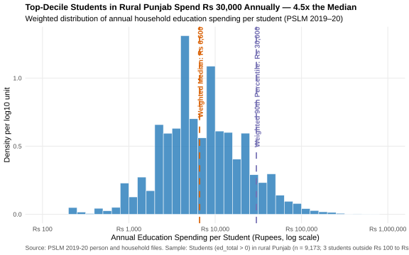
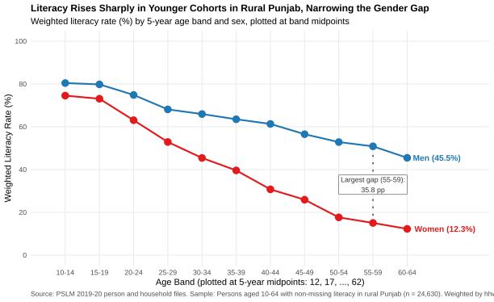
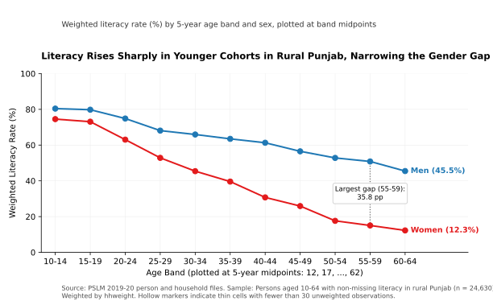

# ECO346 Assignment 1 — FA24-BEDS-024

- **Name:** Fatima Babar Murtaza
- **Registration Number:** FA24-BEDS-024
- **Section:** B
- **Variant:** 0 — Punjab Rural ($24 = 3 \times 8 + 0$)

---

## Question 2: Distribution of Annual Education Spending

### Summary Statistics (Rural Punjab Students, PSLM 2019–20)
- **Number of students (`ed_total > 0`):** 9,173 (9,170 within Rs 100 – Rs 1,000,000)
- **Number excluded (outside Rs 100 – Rs 1,000,000):** 3
- **Weighted median:** Rs 6,600
- **Unweighted median:** Rs 7,000
- **Weighted 10th percentile:** Rs 2,000
- **Weighted 90th percentile:** Rs 30,000
- **90th / 10th percentile ratio:** 15.00

### Interpretation (74 words)
Annual education spending per student in rural Punjab is highly right-skewed in raw rupees (the 90th percentile of Rs 30,000 is 15.00 times the 10th percentile of Rs 2,000), but approximately unimodal on a $\log_{10}$ scale. The weighted median (Rs 6,600) is lower than the unweighted median (Rs 7,000) because PSLM sampling weights (`hhweight`) assign larger population weights to rural enumeration blocks where households spend slightly less on schooling.

---

## Question 3: Literacy Rate by Age Band and Sex

### Full Age-Band Table (Rural Punjab, PSLM 2019–20)

| Age Band | Midpoint | Men (n) | Men Literacy (%) | Women (n) | Women Literacy (%) | Gap (M - W, pp) |
|----------|----------|---------|------------------|-----------|--------------------|-----------------|
| 10-14 | 12 | 2209 | 80.4% | 2133 | 74.5% | 5.9 |
| 15-19 | 17 | 1922 | 79.8% | 1758 | 73.1% | 6.7 |
| 20-24 | 22 | 1449 | 74.9% | 1574 | 63.1% | 11.8 |
| 25-29 | 27 | 1201 | 68.1% | 1386 | 52.9% | 15.2 |
| 30-34 | 32 | 1037 | 65.9% | 1176 | 45.4% | 20.5 |
| 35-39 | 37 | 1006 | 63.5% | 1194 | 39.6% | 23.9 |
| 40-44 | 42 | 843 | 61.3% | 903 | 30.7% | 30.6 |
| 45-49 | 47 | 737 | 56.5% | 776 | 25.9% | 30.6 |
| 50-54 | 52 | 708 | 52.8% | 657 | 17.6% | 35.2 |
| 55-59 | 57 | 517 | 50.8% | 535 | 15.0% | 35.8 |
| 60-64 | 62 | 497 | 45.5% | 412 | 12.3% | 33.2 |

### Economic Interpretation (89 words)
In rural Punjab, literacy rises steadily from older to younger cohorts for both sexes, reflecting long-run generational expansion in school access. Men aged 55–59 have a 50.8% literacy rate compared with 15.0% for women (the largest gender gap at 35.8 percentage points), whereas among 15–19 year-olds literacy reaches 79.8% for men and 73.1% for women (narrowing the gap to 6.7 percentage points). Because the data come from a single cross-section, the figure cannot separate birth-cohort schooling gains from life-cycle aging or differential mortality effects.

---

## Question 4: The Makeover

### Makeover Explanation (134 words)
First, the default scatterplot suffers from severe **overplotting** because binary outcomes (`0` or `1`) at integer ages stack 24,630 points on top of one another; aggregating into 5-year **conditional means** (weighted literacy rates) reveals the underlying age-literacy relationship. Second, encoding sex and literacy rates via **vertical position on a common scale** with distinct colour-coded lines leverages the highest-ranked perceptual channel for comparing trends. Third, replacing an external legend with **direct series labels** and directly annotating the maximum gender gap (35.8 pp at ages 55–59) increases the **data-ink ratio** and reduces eye movement. Finally, encoding **sample size reliability** with solid vs. hollow markers indicates whether any cell is thin ($n < 30$). One feature the default figure shows that the redesign hides is that individual literacy is strictly binary (`0` or `1`) at each single year of age.

---

## Question 5: Replication in Python

- **Women aged 15–19 literacy rate (R):** 73.1%
- **Women aged 15–19 literacy rate (Python):** 73.1%

### Comparison of Defaults (65 words)
By default, R's `ggplot2` (`theme_minimal`) removes top and right axis borders, includes subtle background gridlines, and left-aligns the plot title, whereas Python's `matplotlib` draws a four-sided black bounding box (`spines`), omits gridlines, centers the title, and clips direct labels outside the data range. To make the Python figure match R, I hid the top/right spines, enabled light gridlines, left-aligned the title, and set `xlim(10, 71)`.
